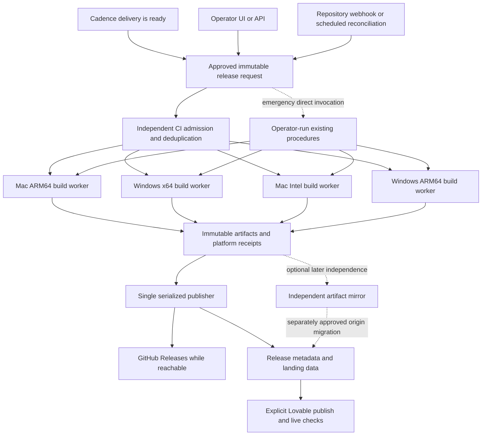

# Release The Boss independently of GitHub Actions

## Recommendation

**Prepare an independent release execution path, then pilot Buildkite with native workers as the preferred managed candidate. Keep the same build and publication procedures callable without Buildkite.** Initially retain GitHub as source and installer hosting; remove Actions from every required orchestration step. If freedom from any vendor-operated scheduler is a hard requirement, evaluate self-managed Jenkins instead. Neither choice supplies the native machines, signing credentials or release correctness automatically. **The choice is conditional on publication access, four native workers and acceptable total cost; this is not a completed migration or purchase recommendation.** [inferred: local inspection L1–L6; sources S01–S07, S12–S13, S27, S33]

The fastest recovery is not to rebuild our release system while customers wait. Prepare an operator-triggered release on available native machines, reusing packaging scripts and adding the bounded publication adaptation described below. Complete the metadata and website stages outside Actions too. A Buildkite proof of operation can follow on the two critical platforms, then extend to all four. Hardware and publication access are unverified prerequisites—not assumptions that four machines and a working publisher already exist.

GitHub remains useful as a repository and download mirror. This incident establishes that **our Actions jobs are currently refused**; it does not establish that GitHub Git, Releases, every CI vendor or GitHub generally is unusable. A sensible response removes the demonstrated single point of failure without pretending another SaaS platform cannot fail.

## What the evidence establishes

Here, **verified** means a fetched primary source or inspected local artifact supports the statement. It does not mean a new CI provider has built our application. **Inferred** marks a recommendation; **unverified** marks an unmet prerequisite.

| ID | Finding | Label and evidence |
|---|---|---|
| L1 | Release run 36924951718, attempt 3, failed before any build steps. Its check annotation says the account is locked due to a billing issue. | Verified: [run](https://github.com/Prometheus-AGS/the-boss/actions/runs/36924951718/attempts/3), check 110749594246 re-read in this research. |
| L2 | The replacement token authenticated as GQAdonis and could read repository admin permissions, but the preceding retry request was denied as inaccessible to that token. | Observed in the preceding turn; not rerun here. Token permission failure and job-admission billing lock are different failures. No secret included. |
| L3 | The release source inspected is `61bc79e8ec039de31d524d2c8d2883dc7e47cce6`, version 2.2.10. | Verified: isolated `upstream-grok-compatibility` worktree. Report destination main checkout is separately at `e2ae2ce21245030293c0bea96ed02ae853b820a7`; it was not updated. |
| L4 | Three Actions-dependent stages exist: installer build, Boss metadata publication, and landing data refresh. | Verified: Boss workflow and publication scripts; landing workflow. Exact references in [local evidence](research/independent-release-cicd-20261002-a7c1/local-evidence.md). |
| L5 | Existing native package validation rejects a different host OS/architecture; it inspects installed/mounted packages and probes native payloads. | Verified: `scripts/validate-release-package.cjs:23`, `:59`, `:105`, `:134`. |
| L6 | Download publication is not established automatic application updating: the inspected updater configuration still points at Cherry's generic host, and this publisher selects DMG/setup.exe assets. | Verified source observation: `electron-builder.yml:200`, `AppUpdaterService.ts:32,100`, `publish-installers.cjs:20`. No updater network trace performed. |

**The precise account-lock cause remains unresolved.** Neither the screenshot, the token check nor public documentation proves an exhausted budget, outstanding debt or the deleted organization's causal role. Changing CI is an availability decision; it is not a diagnosis of GitHub's internal billing state.

## The dependency that a runner swap misses

The current path is:

Buildkite, Jenkins or a developer terminal can execute the build commands, but a build-only migration still stalls at D or F. A successful GitHub API dispatch is also not evidence that the downstream job ran.

Current payload downloads include Compass, filesystem MCP, Prometheus, PK, liter-llm and UAR assets hosted on GitHub Releases. The UAR importer and landing synchronizer deliberately validate GitHub-specific release URLs. A total GitHub exit therefore requires a reviewed artifact-origin migration, not just different CI YAML. These checks should remain intact during initial recovery. [L4; local evidence]

Adding a GitHub self-hosted runner changes compute, not the scheduler. GitHub still assigns jobs to that runner. **Do not count that, an Actions-backed runner vendor, another PAT, or local Actions emulation as a proven escape from the current lock.** Whether a self-hosted Actions job is allowed under this particular lock is unverified; its control-plane dependency is documented. [S27](https://docs.github.com/en/actions/reference/runners/self-hosted-runners)

## Options compared

The dispositions below are inferences from the cited capabilities and this repository. “Supported agent” is not a certificate that our Electron, NSIS, UAR or signing stack operates there.

| Option | Trigger/control plane | Mac and Windows fit | Main trade-off | Disposition |
|---|---|---|---|---|
| **Buildkite + self-hosted native agents** | Independent UI, API, schedules and repository webhooks; exact commit supplied to Builds API. | Mac Intel/ARM documented; published v4.1.0 agent assets include Windows AMD64 and ARM64. We provide or rent hosts. | Low controller administration, but another SaaS dependency remains; maintain manual fallback. | **Preferred managed pilot, subject to cost and access gates.** [S01–S04, S33] |
| **Jenkins, self-managed** | Our controller; authenticated remote build API, manual jobs and scheduled/polling triggers. | Labeled native workers; agent requires compatible Java and tools. Windows ARM JDK/agent/toolchain must be qualified. | We own patching, backup, access control, plugin restraint and recovery. | **Preferred sovereign scheduler** if that operational responsibility is acceptable. [S05–S07, S26] |
| **GitLab CI + own runners** | GitLab UI/API; self-managed GitLab removes a hosted scheduler dependency. | Official Windows ARM64/AMD64 binaries; Mac Intel/ARM supported. | More repository/control-plane setup. Turnkey CI for an external GitHub repo is Premium/Ultimate; a separately managed mirror or CI project has its own synchronization work. | Strong alternative if adopting GitLab as a broader platform is desirable. [S08–S09, S25, S31] |
| **TeamCity** | Cloud or own server, REST build queue, native agents. | Broad OS/JVM support; exact Windows ARM qualification still needed. | More controller/licensing decisions than immediate recovery requires; no measured advantage for this app. | Viable, not first migration choice. [S16–S17] |
| **Codemagic** | Separate Builds API; managed builders. | Published Windows 2022 and Apple Silicon capacity. No native Windows ARM/Intel-Mac provision established by this research. | Attractive critical-platform stopgap; native four-target coverage remains incomplete. | Pilot candidate for Mac ARM + Win x64, not a proven whole-matrix replacement. [S14–S15, S28] |
| **CircleCI** | Independent service; own machine runners poll CircleCI. | Its supported own-runner list includes both Mac architectures and Windows x64, not Windows ARM64. | Still a SaaS controller and needs an ARM solution. | Lower fit than Buildkite/GitLab for our full matrix. [S10] |
| **Azure Pipelines** | Separate Azure DevOps controller; hosted or own agents. | Hosted Intel and Windows options; ARM Mac documentation has multiple preview paths, including a GitHub-hosted Agents pool. | Entitlement, preview, capacity and provider coupling must be clarified; not assumed independently available. | Conditional option, not the fastest well-evidenced four-platform answer. [S18, S32] |
| **Operator-run native release** | Direct authenticated invocation on machines we control, independent of any CI scheduler. | All four only if all four native environments exist. | Weak queue visibility until wrapped; operator must preserve receipts and publisher serialization. | **Immediate recovery/fallback**, not a new custom CI product. [L3–L5] |

### Important Buildkite caveats

- Its GitHub Actions workflow compatibility feature is in preview and excludes Windows shells/jobs; runtime matrices from previous job outputs are also listed as unsupported. The Boss has a generated matrix. **Translate a thin orchestration layer around existing scripts; do not promise direct YAML import.** [S11](https://buildkite.com/docs/pipelines/migration/run-github-actions-workflows)
- Hosted Windows agents are private preview, AMD64-only, and do not expose desktop access. They cannot be the committed Windows ARM supply plan. [S12](https://buildkite.com/docs/agent/buildkite-hosted/windows)
- Hosted Mac agents are Apple Silicon and require Pro/Enterprise. Intel still needs separate native capacity under our current validation contract. [S13](https://buildkite.com/docs/agent/buildkite-hosted/macos)
- Self-hosted agent releases include all four architecture binaries, but obtaining and qualifying four build environments is our responsibility. [S33](https://api.github.com/repos/buildkite/agent/releases/tags/v4.1.0)

### Azure documentation ambiguity

Microsoft's hosted-agent page says the older macOS 15 ARM preview is paused. A separate Microsoft announcement describes Apple Silicon via a pay-as-you-go **GitHub-hosted Agents** pool. These are different offerings, not evidence that all ARM hosting is unavailable. Neither source proves this account can use the new pool or that it avoids the incident's failure domain. This uncertainty is retained, not resolved by selecting whichever page favors a recommendation. [S18](https://learn.microsoft.com/en-us/azure/devops/pipelines/agents/hosted?view=azure-devops), [S32](https://devblogs.microsoft.com/devops/apple-silicon-and-xcode-27-images-availabile-in-pay-as-you-go-preview/)

## Proposed release architecture

The release contract belongs to the repository; the CI system only admits and runs it. Do not build another UAR scheduler, KBD controller or Cadence daemon for CI.

**Trigger contract — proposed, not implemented:** each request records a release/candidate ID, exact Boss commit, recursive submodule SHAs, locked dependency references, UAR and native-payload manifests, version/profile, targets, approvals and the publication destination. A webhook is a notification to reconcile approved requests—not authority to release arbitrary pushed code. A manual/API path supplies the same request. Scheduled reconciliation recovers missed notifications without creating a new candidate every two hours.

An external runner must select the exact SHA and verify it after checkout. Branch names alone move. Tag-only APIs should resolve an immutable tag and compare its commit with the request before executing. A mirror must contain that commit and all submodule commits before admission.

**Resume semantics:** preserve platform receipts by candidate/source/platform; resume incomplete work instead of rebuilding successful artifacts because another architecture failed. Never replace an already-published version/filename with different bytes. Retry publication separately from build. Treat a timed-out upload as uncertain until the destination is inspected by digest and size. Different candidates must never be silently aggregated.

**Single publisher:** use one serialized release queue plus durable per-candidate publication records. It merges each finished platform without erasing other platforms or previously available downloads, updates release metadata, updates the landing data, publishes Lovable, and checks the exact public download bytes. A CI “success” indicator does not replace these receipts. Prevent a late older job from rolling the website back.

**Cadence:** keep 120-minute development increments, a local Mac ARM64 build and actual operation of the completed function each delivery, and full Mac/Windows publication every second successful delivery or explicit request. Build a frozen candidate in a separate release workspace while independent implementation continues on the next approved increment. Serialize writers to a shared target directory; impose per-machine capacity limits. Do not let CI add unit/per-edit/broad test loops. Build errors are corrected before that candidate is declared delivered. Builds, launch, feature operation, publication and installed acceptance remain separate records.

## Recovery sequence using current scripts

This is a proposed runbook, not something executed during research.

**Publication admission comes before expensive builds.** During a later authorized recovery, establish source/payload readability and the precise credentials and permissions for release creation/upload, Boss metadata write, landing write and Lovable publication. Where a read-only check cannot establish write eligibility, use a clearly identified private draft release and controlled repository branch or staging publication, inspect the result, and record/clean up the rehearsal artifacts. This research performed no such mutations. A token's repository-admin field alone is insufficient.

If GitHub refuses release writes, **stop admitting full remote builds** until an alternate path is approved. Proposed fallback: immutable installers in an independently controlled R2 bucket under an owned download domain, with digest-qualified manifests and the existing Lovable site updated through a reviewed alternate-origin path. Current source validators are GitHub-specific, so this fallback requires a bounded implementation decision before use; it is not available today and this report does not authorize that migration. If GitHub Git writes also fail, a Lovable-side update or independent static-site deployment and reconciliation strategy must be established first. Do not finish four builds and discover at the end that no authorized publication path exists.

1. **Inventory real access.** Identify available Mac ARM, Windows x64, Intel Mac and Windows ARM hosts. Verify native toolchain, disk, signing access and permitted publisher identities. The user's Windows machine is known to run The Boss; it is not yet a provisioned build worker. Do not enroll a daily-use machine with broad developer secrets as an unrestricted CI runner.
2. **Freeze the recovery source.** Use the inspected 2.2.10 SHA, or explicitly approve a newer candidate after reconciling source changes. Preserve all submodule and payload pins. Use clean disposable release checkouts, not the dirty main checkout.
3. **Reuse current commands.** Node `24.21.0`, pnpm `12.6.0`, recursive submodules, capacity checks, payload import/download and native release commands are source requirements. Preserve the existing 10 GiB minimum disk preflight; measure peak use before selecting paid runner sizes rather than assuming that minimum is comfortable capacity.
4. **Build the two customer-critical platforms first, then the other two.** Use `build:mac:arm64:release:uar`, `build:win:x64:release:uar`, `build:mac:x64:release:uar`, and `build:win:arm64:release:uar` on matching hosts. Preserve the local `pnpm build:mac:arm64` delivery requirement. Do not substitute cross-build success for native operation.
5. **Operate the completed packages.** Native package checks plus actual launch/feature operation are the boundary. Windows services do not provide an interactive desktop; provision a controlled interactive session for UI operation. A service job's successful installer execution is not a visible app acceptance receipt. [S08](https://docs.gitlab.com/runner/install/windows/)
6. **Publish outside Actions.** Use the existing release preparation/upload logic and invoke the publisher serially. The current scripts still emit dispatch events; do not wait for those events to run. Explicitly execute the landing sync/build/push work externally too. Keep a clear single owner to avoid competing with an Actions retry if it unexpectedly starts.
7. **Publish the existing Lovable project.** Verify the expected repository commit has synced, then publish and confirm the live release/version/URLs. Git sync and live deployment are separate in Lovable. No domain migration is needed for the initial recovery. [S22](https://docs.lovable.dev/integrations/git-sync-overview), [S23](https://docs.lovable.dev/features/publish)

Two script hazards must be accounted for in any external adapter: `release-platforms.cjs` expects `GITHUB_OUTPUT`; provide a private job-output file or use the known matrix directly. The publication coordinator performs `git reset --hard` and deletes `manifests/`; execute it only inside a disposable checkout. Do not run it in a user's active workspace. [local evidence]

### Exact handoff from today's Actions stages

These are inspected entrypoints, **not a newly implemented external pipeline**. Commands below are documentation, not executed research actions. Let B be a clean Boss release checkout and L a separate clean landing checkout at the selected revisions. Common Boss inputs are `GITHUB_REPOSITORY=Prometheus-AGS/the-boss`, exact `GITHUB_SHA`, `THE_BOSS_UAR_ENABLED=1`, `THE_BOSS_UAR_LOCAL=0`, selected `RELEASE_PLATFORMS`, and narrowly scoped externally supplied credentials. An environment variable named `GITHUB_SHA` does not require an Actions runner.

| Stage | Entry point | Additional inputs | Receipt / missing adaptation |
|---|---|---|---|
| Freeze/preflight | B: `node scripts/release-preflight.cjs` | `RELEASE_VERSION` or package version | Frozen-input log and exit code; capture explicitly. |
| UAR payload import | B: `node scripts/import-uar-sidecar-payloads.cjs <record-url>...` | Matching source-pinned record URLs, or four documented `UAR_*_RECORD_URL` variables | Validates records but rewrites `build/integration-artifacts.json`; freeze the resulting manifest digest before builds. Never silently substitute later payloads. |
| Prepare draft | B: `node scripts/prepare-github-release.cjs` | Authenticated `gh`, profile and package version | Creates/validates draft release; record its ID and tag. Suitable for the authorized publication admission stage. |
| Installer upload | B: `node scripts/publish-installers.cjs` | Native host, complete `dist`, signing/notarization state | Native validation, upload and `installers-<platform>-<arch>.json`. **Currently uses `--clobber`**; compare existing asset bytes first. Skip exact matches; refuse different bytes and select a new release version before build admission. |
| Immutable manifest | B: `node scripts/queue-release-publication.cjs` | Installer manifest, source/profile/platform | Uploads source-qualified manifest, then unconditionally dispatches Actions. No dispatch-free mode exists today. A dispatch error after upload is a partial effect, not a reason to rebuild. |
| Boss publication | B: `node scripts/coordinate-release-publication.cjs` | `RELEASE_BRANCH`, `RELEASE_TAG`, `RELEASE_VERSION`, `RELEASE_PROFILE`, `RELEASE_PLATFORM`, `RELEASE_ARCH`, `RELEASE_MANIFEST_ASSET`, `LANDING_REPOSITORY`, `LANDING_DISPATCH_TOKEN`, `GH_TOKEN` | Writes metadata through GraphQL, publishes release and verifies bytes, then unconditionally dispatches landing Actions. Disposable checkout only; branch/package version must still match the candidate. |
| Landing data | L: `node scripts/sync-release-platform.mjs --repository Prometheus-AGS/the-boss --tag v2.2.10 --version 2.2.10 --profile uar-enabled --platform <darwin-or-win32> --arch <arm64-or-x64> --manifest-asset <immutable-manifest-name>` | Public release/manifest, optional `THE_BOSS_RELEASE_TOKEN`, existing other-platform entries | Exact public download digest/size and selected `src/lib/release.json` entry; retain outputs. |
| Landing build/push | L: `npm ci --ignore-scripts=false`, `npm run typecheck`, `npm run build`; commit only generated release data and push intended main update | Workflow uses Node22; lockfile and authorized Git identity | Build output and commit SHA. This is the completed site-delivery boundary, not permission for intermediate suites. |
| Live deployment | Existing Lovable project's explicit Publish operation after source synchronization | Authorized project access and expected synced SHA | No repository deployment CLI identified; record actual deployment and live URLs separately. |

**Minimum implementation before calling this reliable automation:** supply explicit CI-context inputs; add a dispatch-free publication seam and truthful external-run provenance; serialize metadata/site mutation; retain stage/effect receipts; guard existing asset bytes; and bind the Lovable publish operation to the expected source revision. The current commit helper hard-codes `[GitHub Actions release packaging]`, so running it elsewhere unchanged would mislabel provenance. No such adapter was written in this research.

Do not solve the duplicate-publication risk merely by hoping Actions stays locked. Select one publication authority for each candidate; if the old workflow can still run, its publisher must be excluded or coordinated before the independent publisher takes ownership. Do not automatically retry an entire script after a final dispatch failure; inspect its already-completed external effects first.

## Signing, secrets and native capacity

The existing macOS workflow enforces Developer ID/App Store Connect prerequisites. Its notarization hook can skip when credentials are absent, and validation is conditional on `HAS_NOTARIZATION`. **An external release must carry over the workflow's enforcement**, not merely call the happy-path packaging command. Record actual signature/notarization results.

Windows signing is also conditional; the custom hook and workflow use different credential switches. Preserve and inspect the actual output's Authenticode result; do not label a build signed because a signing-related environment variable was present. No signing policy is changed here. [local evidence]

Use scoped, separate credentials for source read, release write, landing write and CI triggering; repository admin visibility does not demonstrate permission to mutate a particular API. Buildkite's build-create API has its own `write_builds` authorization. GitHub Release creation remains an ordinary API operation, but permission and account-policy availability must be exercised during the approved publication—not assumed from today's read-only research. [S03](https://buildkite.com/docs/apis/rest-api/builds), [S20](https://docs.github.com/en/rest/releases/releases#create-a-release)

Release/signing workers must not run untrusted pull-request code with secrets. Keep controller execution separate from builders; use temporary signing keychains/credential access and remove secret material after the job. Pin dependency and worker-image inputs. A clean rebuild should not depend on the developer's shell profile or login state. Jenkins specifically recommends keeping builds off its controller. [S07](https://www.jenkins.io/doc/book/security/controller-isolation/)

Do not claim cross-compilation is impossible in general. electron-builder can cross-package some combinations, but native dependencies and macOS signing constrain that. The Boss additionally enforces matching native validation today. Changing that contract to save machine cost would be a separate decision with native operation still required. [S29](https://www.electron.build/v26/docs/features/multi-platform-build/)

## Economics and time to adopt

Prices are a retrieval-date snapshot, not a quote or an authorization to spend.

| Option | Documented price/cost driver | Interpretation for us |
|---|---|---|
| Buildkite | Pro lists **$30/active user/month**, 10 agents included; listed M4 Medium hosted compute is **$0.12/minute**, M4 Large **$0.24/minute**. A Free plan exists with smaller limits. [S04](https://buildkite.com/pricing/) | Own-worker hardware/rental and administration remain additional. Hosted Mac access requires Pro/Enterprise. Illustratively, 60 × 30-minute medium-Mac builds cost $216 compute plus plan charges; our actual build durations are not benchmarked here. |
| Codemagic | Team M2 **$0.095/min**, M4 **$0.114/min**, Windows **$0.045/min**; 500 free M2 minutes apply to individual accounts, not teams. [S14](https://docs.codemagic.io/billing/pricing/) | Illustrative 60 releases with 30-minute M2 + 30-minute Windows jobs cost $252 compute, excluding extra concurrency. Does not cover missing Intel/ARM-native capacity. |
| Jenkins | MIT-licensed core. [S26](https://www.jenkins.io/license/) | No core license purchase; controller hosting, native machines, backups, patching and operator time are real costs. |
| GitLab | Premium lists **$29/user/month, billed annually**; Free exists. Turnkey external-repository CI requires Premium/Ultimate. [S34](https://about.gitlab.com/pricing/), [S25](https://docs.gitlab.com/ci/ci_cd_for_external_repos/) | Own runners still cost money to operate. A Free mirror/CI-project approach requires deliberate synchronization instead of assuming the paid external-repo feature is free. |
| TeamCity | Professional includes **three build agents**; additional agents list **$359/agent/year**. Cloud starts at **$15/committer/month** plus usage. [S35](https://www.jetbrains.com/teamcity/buy/) | Four simultaneously connected/licensed build-agent requirements must be checked against the chosen license; hardware, controller and storage remain additional on-premises costs. |
| CircleCI | Performance starts at **$15/month** with usage credits; compute, users and storage/network affect spend. [S36](https://circleci.com/pricing/) | Its headline free Docker-minute allowance is not a four-platform native budget. Quote relevant machine classes and resolve Windows ARM first. |
| Azure Pipelines | Page lists one free self-hosted parallel job, **$15/month per extra self-hosted parallel job**, and **$40/month per extra Microsoft-hosted parallel job**. New GitHub-hosted Mac agents use separate per-minute pricing. [S37](https://azure.microsoft.com/en-us/pricing/details/devops/azure-devops-services/) | Four self-hosted concurrent jobs would illustrate $45/month beyond the listed first free job, excluding all machines and conditional on this account's eligibility. The new Mac pool is a distinct pricing/control dependency. |
| EC2 Mac capacity | Dedicated hosts have a **24-hour minimum allocation**. [S19](https://docs.aws.amazon.com/AWSEC2/latest/UserGuide/ec2-mac-instances.html) | Renting one solely for a short build is not minute-priced like an ephemeral job; compare with persistent fleet use and other Mac providers before buying. |

The comparison is **not yet a total-cost ranking**. For every retained option obtain the same inputs: monthly controller/license cost; actual Mac ARM, Mac Intel, Windows x64 and Windows ARM host rental or amortization; minimum rental commitments; four-job concurrency; artifact retention/egress; signing/session setup; controller and worker administration; backup/recovery labor. Operator hours and hardware prices have not been measured or quoted and remain unknown rather than zero. Public prices do not establish account eligibility.

| Candidate | Four-worker sourcing and concurrency | Retention and recovery ownership | Operational burden, relative inference |
|---|---|---|---|
| Buildkite own agents | Four owned/rented native environments; Free currently lists up to 10 concurrent jobs; hosted alternatives have the noted coverage gaps. | Free/Pro artifact retention lists 30 days; copy long-lived releases/evidence to durable storage. Vendor controller, our workers and emergency recovery. | Lower controller burden; worker, signing and fallback burden remains. |
| Jenkins | Four owned/rented native environments and suitable JVMs; executors configured by us. | We configure retention, back up controller/config/credentials and own restore procedures. | Highest controller ownership; no SaaS admission dependency. |
| GitLab own runners | Explicit binaries exist for all four; provision/tag workers. Verify account quota/runner policy. | Hosted tier retention/storage terms or our self-managed storage/backup; retention quote still open. | Hosted: medium integration burden. Self-managed: substantial platform operations. |
| TeamCity | Own native workers; qualify Windows ARM JVM/tools; add license or schedule capacity within licensed slots. | Own retention/controller backup on-premises, provider terms in cloud; chosen retention/usage quote open. | Medium/high for on-premises; cloud lowers controller burden. |
| Codemagic | Hosted critical-platform pair; Intel Mac/Windows ARM supply is unproven and requires another path. | Service retention terms need confirmation; preserve independent release evidence. | Low hosted-worker operations but extra orchestration for unsupported targets. |
| CircleCI | Listed self-hosted Mac pair/Win x64; Windows ARM remains unresolved. | Credit/storage/network terms plus own artifact retention; provider controller and our runner recovery. | No demonstrated simplification for the full matrix. |
| Azure | Own four-native-worker route needs qualification; hosted ARM enrollment/preview constraints remain. | Azure retention/storage plus our worker recovery; confirm account quotas and direct trigger access. | Reasonable if Azure DevOps already exists; that was not established. |
| Manual recovery | Same four native environments; serialize explicitly per resource. | We retain request, logs, hashes, publisher receipts and cleanup record. | Low setup, higher hands-on cost; bounded emergency use only. |

No credible fixed completion time can be promised until worker access, enrollment and signing credentials are established. Suggested bounded delivery slices: (A) independent critical-platform build/operation; (B) external serialized publisher through the live site; (C) four-native-platform scheduling and recovery drill. These are deliverables, not a promise that each fits one two-hour slot. Keep the existing product phase moving once a frozen build candidate has been admitted and resources are isolated.

## If we mean complete GitHub independence

Initial migration removes **Actions** dependence. Full independence additionally requires:

1. A verified source mirror containing every pinned submodule commit, or a provenance-preserving source export; private credentials and Git LFS, if used, must be included in the plan.
2. An independent cache/mirror of every required native tool, Electron/runtime download and service image, with existing digests. A source mirror alone cannot rebuild this payload.
3. Independent installer hosting with a stable owned download domain and immutable objects. R2 is one option: Standard storage lists $0.015/GB-month plus operations and no internet egress charge; it is not free or outage-proof. [S24](https://developers.cloudflare.com/r2/pricing/)
4. A reviewed relaxation of GitHub-specific artifact URL validation and landing origins that retains provenance, checksum and origin policy. No IPFS reintroduction.
5. An independent site publishing path. Cloudflare Pages supports prebuilt-asset direct upload, but adopting it would be a separate hosting/domain change. Host installers in object storage, not a static site's small-asset upload path. Preserve current Lovable deployment for first recovery. [S21](https://developers.cloudflare.com/pages/get-started/direct-upload/)

Own storage can also retain CI evidence beyond vendor artifact retention; Buildkite documents external artifact backends. Native workers and emergency procedures should remain usable when the chosen CI service is down. A second always-running scheduler is unnecessary initially; a documented direct invocation path with preserved receipts is sufficient until an outage drill demonstrates otherwise. [S30](https://buildkite.com/docs/agent/cli/reference/artifact)

**Automatic updates are a separate product gap.** This report's release path means installers downloadable from the website. Repairing the app's update feed would require the correct updater metadata/assets, signing compatibility and installed upgrade operation. Do not add that code silently to a CI migration or advertise automatic delivery based solely on installer publication. [L6]

## Decision conditions and acceptance of a later implementation

Choose Buildkite if managed orchestration plus owned workers and a manual fallback meet the independence requirement. Choose Jenkins if owning the scheduler itself matters more than minimizing operations. Choose GitLab if a wider repository/platform move is already wanted. Reject all proposals that promise the complete native matrix without naming where Intel Mac and Windows ARM execute.

**What would change this recommendation:** an already-maintained Jenkins/GitLab/TeamCity controller; a verified provider offering all four native workers at an acceptable price; unavailable Windows ARM capacity; an account policy prohibiting SaaS controllers; or measured fleet costs making owned workers unattractive. None was established in this inspection.

A later migration is done only when one exact frozen candidate builds and operates on **darwin-arm64, darwin-x64, win32-x64 and win32-arm64** while Actions is unused. For each, retain native package-validation, launch/feature-operation, actual signing/notarization state, publication and downloaded-byte receipts. A failed-platform retry must preserve successful bytes; publication must survive interruption without duplicate/replaced assets; source-qualified manifests and public hashes must agree; the live site must point to the correct installers; and installed-acceptance states must remain accurate. Demonstrate this once at the completed delivery boundary. No intermediate test-suite loops are proposed.

## Research and review limits

Firecrawl discovery and primary-page retrieval, Context7 API documentation and one independent local-source inspection ground this report. The first independent adversarial review returned BLOCK with two critical findings; publication admission and comparative cost limits were revised in response. A single bounded correction confirmation returned PASS with no remaining findings. Distinct reviewer-model identity could not be verified; this was an independent fresh-context review, not a proven cross-model review. Final review disposition is recorded in the [research package](research/independent-release-cicd-20261002-a7c1/index.md), alongside sources, labelled claims and unresolved questions. Verification status is **partial** because recommendations are inferred and alternative-provider operation, hardware availability and the automated Feynman gate are not demonstrated. Frontmatter confidence is an editorial claim-weighted aggregate documented in `confidence-method.json`, not a probability of release success; individual claims distinguish sourced capability from unknown access or operation.

No product code, CI configuration, credentials, billing settings, domains or deployment were changed. Existing uncommitted work remains untouched. Only research documents were added; no commits or pushes were made.
